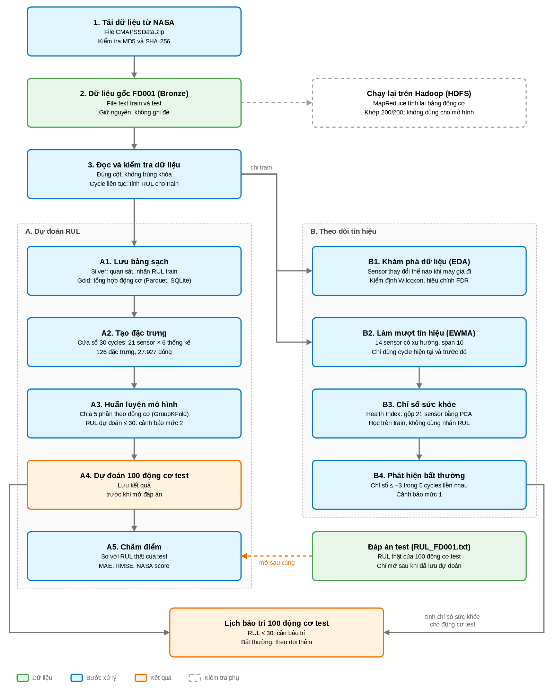
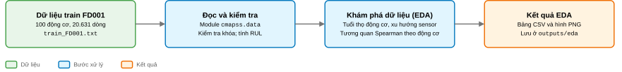
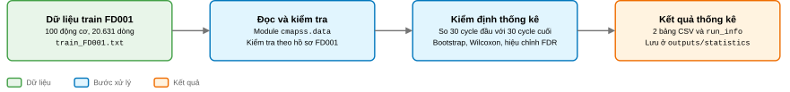

<a href="README.md"> English</a> · <a href="README.vi.md"> Tiếng Việt</a>

<hr>

# Pipeline dự đoán RUL trên NASA C-MAPSS

**Học viên:** Phan Nguyễn Mai Phương · **MSHV:** 25002711.

**Cập nhật lần cuối 07/10/2026:** alignment HGB126/HGB169, reliability code và deck
đã được đồng bộ. Follow-up ngày 29/09 thử capped RUL/history trên FD001, chuẩn hóa theo điều kiện
vận hành trong từng fold trên FD002/FD004 và benchmark Pandas/PySpark theo stage.
Xem [kết quả và cách tái lập](experiments/FOLLOWUP_20260929.md).
Sáu notebook có thông tin học viên; dashboard, notebook và slide dùng chung run
đã rebuild. Dependency slide được khóa bằng `slides/pnpm-lock.yaml`.

Repository này phục vụ báo cáo cuối kỳ môn Phân tích dữ liệu lớn. Báo cáo xây dựng quy trình có khả năng tái lập để phân tích dữ liệu cảm biến đa biến và dự đoán Remaining Useful Life (RUL, tuổi thọ hữu ích còn lại) trên NASA C-MAPSS FD001--FD004. FD001 là subset chính cho phân tích chi tiết; FD002--FD004 được đánh giá trong ma trận chuyển miền bổ sung. Trọng tâm gồm nguồn gốc dữ liệu rõ ràng, phân tích thống kê phù hợp, đánh giá tránh data leakage (rò rỉ dữ liệu), ETL có khả năng mở rộng và trực quan hóa kết quả dễ diễn giải.

## Trạng thái

Repository đã có **kiểm tra dữ liệu FD001--FD004, nhãn RUL train, notebook EDA và suy luận sensor chỉ dùng train FD001, ETL Silver/Gold bằng Pandas/PySpark, rolling features 30 cycles, đánh giá RUL theo engine, phân tích PCA--ARIMA Health Index trên train và ma trận bổ sung window 10 cycles cho cả bốn subset**.

**Đã hoàn tất thử nghiệm cải thiện (27/09/2026):** nested GroupKFold 5×3
so sánh window 10/20/30, 24 cấu hình HistGradientBoosting và ba phương án trọng số.
MAE RUL thấp ở vòng ngoài thay đổi từ 3,6676 thành 3,6730 cycles; số cảnh báo
trễ tăng từ 49 lên 53/100 engines. Cổng promotion giữ lại baseline lịch sử.
Kết quả này tách với alignment audit ngày 07/10, trong đó HGB126 và HGB169 được
chấm trên cùng panel đã lưu. Xem [kết quả và cách chạy lại](experiments/README.md).

Đã có:

- Các file NASA C-MAPSS FD001--FD004 nguyên bản và tài liệu mô tả nguồn; kết quả chính dùng FD001, ma trận bổ sung đánh giá cả bốn subset.
- Trình đọc (reader), bộ kiểm tra (validator) và kiểm thử số dòng, số động cơ, schema, khóa, cycle và nhãn RUL train.
- [Data contract (đặc tả dữ liệu)](data/CONTRACTS.md), CLI xuất báo cáo JSON và tệp khóa phiên bản dependency.
- [Notebook walkthrough xử lý dữ liệu đã chạy](notebooks/00_data_pipeline_walkthrough.ipynb):
  chạy từng bước trên FD001 để thấy cách gom file, lưu trữ, truy vấn (SQL trên
  SQLite, Spark SQL và Pandas trên Parquet), biến đổi thành 126 đặc trưng và join;
  đồng thời kiểm tra mọi quan hệ giữa các bảng trên dữ liệu.
- [Notebook EDA đã chạy](notebooks/01_fd001_eda.ipynb), 12 bảng CSV,
  11 hình và [diễn giải kết quả, bằng chứng kiểm tra](outputs/eda/README.md).
- Danh mục tài liệu tham khảo và hướng dẫn đọc.
- Báo cáo [LaTeX](report/README.md) và [PDF](report/main.pdf) trình bày kiểm tra
  dữ liệu, EDA, suy luận sensor chỉ dùng train, parity ETL, rolling features,
  đánh giá RUL theo engine, PCA--ARIMA, cảnh báo sớm và ma trận FD001--FD004.
  Báo cáo có data dictionary (từ điển dữ liệu), bảng thuật ngữ, phân tích lỗi
  và ghi chú tái lập; PDF đã biên dịch có 49 trang.
- Cơ sở lý thuyết có trích dẫn và [quy trình thống kê](report/sections/methodology.tex) (Mục 4.6).
  Đã chốt so sánh giá trị trung bình của 30 cycles đầu và 30 cycles cuối theo từng động cơ.
  Cấu hình thống kê đã được chốt trước khi chạy suy luận.
- Helper `build_engine_sensor_pairs` chỉ nhận train, tạo và kiểm tra một cặp
  30 cycles đầu/cuối cho từng động cơ và đủ 21 sensor.
- Helper tính chênh lệch cặp trung bình theo đơn vị gốc, percentile bootstrap CI, Wilcoxon
  permutation và Benjamini-Hochberg FDR theo cấu hình đã chốt.
- [Notebook suy luận đã chạy](notebooks/02_fd001_inference.ipynb), hai
  bảng CSV, metadata (siêu dữ liệu lần chạy) và [ghi chú validation](outputs/statistics/README.md).
  Đầu ra giữ đủ 21 sensor và không đọc quan sát test hoặc nhãn test.
- Hình được tạo từ các artifact trên: [phân phối chênh lệch](outputs/statistics/figures/difference_distributions.png)
  và [effect size kèm bootstrap CI](outputs/statistics/figures/effect_size_ci.png).
- Pipeline ETL Pandas ghi observations và train targets đã gán kiểu vào Silver
  Parquet, ghi engine summary vào Gold Parquet/SQLite, lưu checksum raw và đo
  benchmark cô lập ở scale 1x/10x/100x trong [outputs/etl](outputs/etl/README.md).
- Adapter PySpark lazy import và bộ đối chiếu cho cùng các boundary Silver/Gold
  đã có. Lần chạy local hiện tại dùng JRE portable và ghi `outputs/etl/parity.json`;
  cả ba boundary Pandas/PySpark khớp với `max_abs_diff=0.0`.
- Pipeline rolling features deterministic trong [outputs/features](outputs/features/README.md).
  Artifact hiện có 27.927 dòng Gold từ trailing window 30 cycles, giữ đủ 21
  sensors, tạo 126 cột đặc trưng và không ghép nhãn test.
- Pipeline modeling theo group trong [outputs/modeling](outputs/modeling/README.md).
  Pipeline so sánh median baseline, Ridge và HistGradientBoosting bằng 5-fold
  GroupKFold theo engine, ghi out-of-fold predictions, ghi đúng 100 test
  predictions trước khi đọc nhãn và đánh giá model được chọn bằng nhãn NASA.
- Phân tích [PCA--ARIMA trên Health Index](outputs/timeseries/README.md) chỉ
  dùng train: 10 engine validation đại diện, chia 70/30, 704 điểm dự báo, khoảng
  dự đoán 95%, ADF và Ljung--Box; không đọc nhãn test.
- [Dashboard Streamlit đọc artifact](app.py) gồm tám trang: tổng quan, dữ liệu và
  EDA, đánh giá RUL (test engine và quỹ đạo OOF), cảnh báo sớm, cross-dataset,
  thử nghiệm cải thiện, Health Index/ARIMA và provenance. Biểu đồ Altair tương
  tác được. Dashboard không fit lại model và không đọc nhãn test thô khi mở trang.
- Ba notebook rà soát kết quả đã chạy:
  [modeling và cảnh báo sớm](notebooks/03_fd001_modeling_evaluation.ipynb),
  [Health Index/ARIMA](notebooks/04_fd001_health_index_arima.ipynb) và
  [cross-dataset cùng thử nghiệm cải thiện](notebooks/05_cross_dataset_and_improvement.ipynb).
  Mỗi notebook tính lại metric từ prediction đã lưu bằng hàm của package, rồi dùng
  `assert` để so với artifact; không fit model và không ghi vào `outputs/`.

Gói bàn giao cuối:

- Đã có [slide trình bày](slides/cmapss_fd001_presentation.pptx)
  ([PDF](slides/cmapss_fd001_presentation.pdf)) gồm 20 slide cho bài nói 18--20 phút,
  chia năm phần: bài toán và dữ liệu, pipeline Big Data, phân tích chuỗi thời
  gian, mô hình và đánh giá, mở rộng và kết luận. Số liệu trên slide được đọc từ
  `outputs/` bằng [`slides/extract_slide_data.py`](slides/extract_slide_data.py);
  [kịch bản nói](handoff/SPEECH_SCRIPT_VI.pdf) ghi thời lượng từng slide;
  [checklist bàn giao](handoff/FINAL_HANDOFF.md) ghi nguồn kiểm tra.

Lệnh cài đặt, kiểm tra dữ liệu, mở notebook, chạy ETL, tạo rolling features,
modeling và PCA--ARIMA có ở phần Bắt đầu. Dashboard dùng dependency tùy chọn
`dashboard`.

## Mục tiêu

Báo cáo tập trung trả lời sáu câu hỏi chính trên FD001:

1. FD001 có đạt kiểm tra schema, khóa và cycle liên tục hay không?
2. Sensor thay đổi thế nào giữa đầu và cuối vòng đời động cơ?
3. ETL Pandas và PySpark có cho kết quả tương đương trên cùng input hay không?
4. HGB126 hay HGB169 ổn định hơn trên cùng panel trajectory và endpoint?
5. Dự đoán RUL hỗ trợ cảnh báo sớm với chất lượng ra sao?
6. Model huấn luyện trên FD001 hoạt động thế nào khi áp dụng FD002--FD004?

Mục tiêu chính là **dự đoán RUL**. Supervised regression (hồi quy có giám sát) là cách mô hình hóa phù hợp vì biến mục tiêu là số cycle còn lại; đây không phải tên hoặc mục tiêu của báo cáo.

## Dữ liệu

Báo cáo dùng bốn subset mô phỏng NASA C-MAPSS. FD001 là subset chính cho phân tích chi tiết; FD002--FD004 phục vụ đánh giá bổ sung.

| Subset | Dòng train | Dòng test | Engine train | Engine test và nhãn |
| --- | ---: | ---: | ---: | ---: |
| FD001 | 20.631 | 13.096 | 100 | 100 |
| FD002 | 53.759 | 33.991 | 260 | 259 |
| FD003 | 24.720 | 16.596 | 100 | 100 |
| FD004 | 61.249 | 41.214 | 249 | 248 |

Mỗi subset có các file `train_FD00x.txt`, `test_FD00x.txt` và `RUL_FD00x.txt`. Lịch sử train kết thúc khi hỏng; lịch sử test bị cắt, kèm một nhãn RUL riêng tại cycle quan sát cuối của mỗi engine. Quy mô được đối chiếu với [artifact ETL theo subset](outputs/cross_dataset/README.md).

Mỗi quan sát gồm:

- Mã động cơ.
- Cycle vận hành.
- Ba thông số vận hành (operational settings).
- Giá trị của 21 cảm biến (sensor measurements).

FD001 đại diện cho một điều kiện vận hành và một dạng suy giảm High-Pressure Compressor. FD002--FD004 mở rộng số điều kiện vận hành và dạng lỗi. Tín hiệu chứa nhiễu cảm biến mô phỏng. Ma trận metric bổ sung cho FD002--FD004 nằm trong `outputs/cross_dataset`.

### Nguồn gốc và tính toàn vẹn

- [Bản ghi NASA Open Data](https://data.nasa.gov/dataset/cmapss-jet-engine-simulated-data)
- [Bản lưu có DOI và checksum](https://doi.org/10.5281/zenodo.15346912)
- Checksum ZIP đã ghi nhận: `MD5 79a22f36e80606c69d0e9e4da5bb2b7a`
- Ghi chú nguồn trong repository: [`data/raw/DATA_SOURCE.md`](data/raw/DATA_SOURCE.md)

Đây là dữ liệu mô phỏng, không phải telemetry thu trực tiếp ngoài thực địa. Kết
quả phục vụ so sánh học thuật tái lập, trong đó FD001 là subset chính và
FD002--FD004 là các đánh giá bổ sung; kết quả chưa chứng minh hiệu quả khi triển khai thực tế.

## Kiến trúc dữ liệu

```text
Các file text gốc của NASA
        |
        v
Bronze: dữ liệu nguồn bất biến
        |
        v
Silver: observations có kiểu dữ liệu, đã kiểm tra và lưu Parquet
        |
        v
Gold: engine summary, rolling features, predictions, metrics và bảng SQLite
        |
        +-------------------+
        |                   |
        v                   v
Phân tích thống kê      Mô hình dự đoán RUL
        |                   |
        +---------+---------+
                  v
       Hình minh họa, dashboard Streamlit
       và báo cáo LaTeX cuối kỳ
```


### Quan hệ dữ liệu và công cụ

Mỗi dòng được định danh bởi `(split, engine_id, cycle)`. Một engine có nhiều
cycle; tại mỗi cycle có 3 operational settings, 21 sensors và nhãn RUL của
train. Với engine kết thúc ở cycle 200, observation tại cycle 170 có RUL = 30.
Rolling window tại cycle 170 lấy cycles 141--170 của cùng engine để tạo 126
features (6 phép tóm tắt cho mỗi 21 sensor).

| Bước | Công cụ | Đầu ra chính |
| --- | --- | --- |
| Đọc và kiểm tra | Python, Pandas | Schema, khóa, cycle continuity, train RUL |
| ETL | Pandas, PySpark, Parquet, SQLite | Silver/Gold và parity |
| Features | Pandas, NumPy | Window 30 cycles, 126 features |
| Modeling | scikit-learn | GroupKFold và HistGradientBoostingRegressor |
| Đánh giá | scikit-learn, SciPy | MAE, RMSE, NASA score, bootstrap CI |
| Trực quan hóa | Matplotlib, Seaborn, Streamlit | Hình, dashboard và kết quả |

FD001 hiện chưa đủ lớn để tự gọi là Big Data. Báo cáo thể hiện khả năng mở
rộng qua ETL Bronze/Silver/Gold, Parquet, PySpark parity và benchmark 1x/10x/100x.

Pandas đã được dùng trong notebook EDA, làm reference cho ETL, thống kê và
chuẩn bị dữ liệu mô hình. PySpark tái hiện ETL và rolling features để đối chiếu.
Benchmark bổ sung 1x/10x đo cả hai engine, gồm I/O và RSS của process tree;
Spark ghi qua Arrow trên driver. Bộ dữ liệu gốc chỉ có dung
lượng vài MB, vì vậy repository không tuyên bố FD001 tự thân chứng minh khả
năng xử lý dữ liệu quy mô lớn.

### Cách đọc, truy vấn và biến đổi dữ liệu

Tài liệu [walkthrough xử lý dữ liệu](handoff/DATA_WALKTHROUGH.md) giải thích
theo đúng artifact hiện có cách đọc hai file observations, `union` train/test,
giữ `split`, tạo RUL train, tạo rolling window, chọn 126 feature columns và
join theo `(split, engine_id, cycle)`. Tài liệu cũng nêu rõ SQLite chỉ chứa
`engine_summary` và `train_targets`; observations được đọc từ Silver Parquet.

FD001--FD004 được xử lý riêng trong các thư mục subset. Không union bốn subset
thành một bảng chung vì khóa hiện tại chưa có `dataset_id`. Quan hệ chính là
engine--observations một-nhiều; join feature với target và prediction với test
label là một-một. Project chưa triển khai quan hệ nhiều-nhiều, Airflow hoặc
Power BI. [Sơ đồ quan hệ có thể chỉnh sửa](assets/diagrams/data-relations.drawio)
và [bản SVG](assets/diagrams/data-relations.svg) thể hiện các boundary này.

Trong ETL, “chuẩn hóa” nghĩa là kiểm tra schema và chuyển kiểu dữ liệu. Scaling
giá trị sensor là bước riêng: Ridge dùng `StandardScaler` trong từng training
fold, còn Health Index dùng `StandardScaler` trước PCA. HGB dùng feature theo
thang gốc; rolling feature pipeline không fit một scaler chung.

## Phương pháp

### Chất lượng dữ liệu

- Kiểm tra schema 26 cột và kiểu dữ liệu số.
- Bảo đảm khóa `(split, engine_id, cycle)` không trùng.
- Kiểm tra cycle liên tục trong từng động cơ.
- Ghi lại số dòng trước và sau mỗi phép biến đổi.
- Giữ phạm vi engine ID riêng biệt giữa train và test.

### Phân tích thống kê

- So sánh hành vi cảm biến ở giai đoạn đầu và cuối vòng đời theo từng động cơ.
- Báo cáo chênh lệch cặp trung bình theo đơn vị gốc và khoảng tin cậy bootstrap 95%.
- Dùng paired Wilcoxon signed-rank test khi phù hợp.
- Kiểm soát multiple testing (kiểm định nhiều giả thuyết) trên các cảm biến bằng Benjamini-Hochberg FDR.
- Ước lượng độ bất định của các metric đánh giá bằng bootstrap theo động cơ.

### Xây dựng đặc trưng

Biểu diễn đặc trưng đã triển khai sử dụng trailing window dài 30 cycles. Artifact giữ đủ 21 sensors để chưa thực hiện feature selection trên toàn bộ train. Với mỗi sensor, các đặc trưng đã tạo gồm:

- Giá trị gần nhất.
- Trung bình và sample standard deviation (`ddof=1`).
- Giá trị nhỏ nhất và lớn nhất.
- Độ dốc xu hướng tuyến tính theo vị trí 1--30 trong window.

Mỗi window chỉ chứa dữ liệu của một động cơ và không sử dụng quan sát tương lai. Engine dưới 30 cycles bị từ chối thay vì padding, impute hoặc rút ngắn window.

### Dự đoán RUL

Pipeline modeling lịch sử đã so sánh:

1. Naive baseline theo trung vị RUL.
2. Ridge regression làm baseline tuyến tính có regularization.
3. HistGradientBoostingRegressor làm mô hình ứng viên phi tuyến (HGB126).

Mô hình được chọn bằng GroupKFold 5-fold, trong đó `engine_id` xác định group.
Nhãn test chính thức của NASA được cô lập cho đến khi đã ghi final predictions.
HistGradientBoostingRegressor được giữ làm baseline lịch sử. Metric test của baseline gồm
mean engine-level MAE 15,3490, RMSE 20,5413 và NASA score 1.513,2577; khoảng tin
cậy bootstrap được lưu trong `outputs/modeling/tables/final_metrics.json`.

### Vai trò predictor và policy cảnh báo

Để tách các protocol, HGB126 là baseline lịch sử; metric test FD001 ở trên chỉ
thuộc mô hình này. HGB169 bổ sung `cycle` và 42 history features vào 126 rolling
features. Alignment audit trên cùng panel OOF đã lưu cho thấy HGB169 có sai số
thấp hơn ở trajectory và endpoint, nên được giữ là predictor candidate có điều
kiện. Đây là read-only replay trên prediction đã lưu, chưa phải blind refit và
không thay thế metric test của HGB126. Warning sensitivity được đánh giá riêng
trên OOF: threshold 30 có on-time 51% với HGB126 và 45% với HGB169; threshold
40 lần lượt là 94% và 96% nhưng burden tăng. Đây chưa phải policy bảo trì đã
hiệu chuẩn.

### Đánh giá FD002--FD004

Kho raw đã có đủ FD001--FD004. Ma trận bổ sung dùng cùng pipeline với window 10
cycles vì test FD004 có engine ngắn nhất 19 cycles; kết quả này không thay thế
metric chính FD001 dùng window 30. Evaluation nội bộ đạt MAE 21,9258 trên FD001,
22,3556 trên FD002, 28,3255 trên FD003 và 27,2218 trên FD004. Khi giữ nguyên
model fit trên FD001 rồi transfer sang dataset khác, MAE là 60,3215 trên FD002,
47,3949 trên FD003 và 58,5731 trên FD004. Kết quả cho thấy không nên dùng trực
tiếp model FD001 cho subset khác nếu chưa huấn luyện lại hoặc điều chỉnh theo
dữ liệu của subset đó.
Xem [artifact ma trận transfer](outputs/cross_dataset/README.md).

### Phân tích ARIMA

ARIMA là phân tích chuỗi thời gian phụ, không phải mô hình RUL chính. Pipeline
đã triển khai chọn 10 engine validation trước khi dự báo, huấn luyện StandardScaler và
PCA trên 90 engine train còn lại rồi transform các engine được chọn, sau đó dùng 70% đầu chuỗi để fit và
30% cuối để đánh giá:

- MAE và RMSE của dự báo.
- Tỷ lệ bao phủ của khoảng dự đoán 95%.
- Chẩn đoán tính dừng Augmented Dickey-Fuller.
- Chẩn đoán tự tương quan phần dư Ljung-Box.

Lần chạy hiện tại fit hội tụ cả 10 engine; MAE nằm trong khoảng 0,1515--1,0372
và tỷ lệ bao phủ khoảng dự đoán 95% nằm trong khoảng 21,43%--97,03%. ADF không bác
bỏ tính không dừng trên các đoạn huấn luyện. Sau khi điều chỉnh Ljung--Box theo
`p+q`, engine 69 và 70 có p-value dưới 0,05. ARIMA không được áp dụng trực tiếp lên
nhãn RUL train; dự báo Health Index không phải RUL.
Trên cùng đoạn dữ liệu giữ lại để kiểm tra, MAE trung bình của ARIMA là 0,4110, của `drift` là 0,7469 và
của `last_value` là 0,9478; đây là so sánh mô tả, chưa phải bằng chứng ưu thế
thống kê. ARIMA không thay thế predictor RUL và không được dùng để chọn HGB126
hay HGB169.

Ma trận đại lượng cần ước lượng, đơn vị phân tích, cách chia dữ liệu/khoảng dự báo, metric và vai trò báo cáo
được lưu trong
[`outputs/modeling/tables/evaluation_protocol.csv`](outputs/modeling/tables/evaluation_protocol.csv).
Phân tích cảnh báo sớm dùng OOF train của HGB126 baseline lịch sử với ngưỡng cố
định RUL <= 30 cycles: 44 engine cảnh báo trước ngưỡng, 7 đúng ngưỡng và 49
sau ngưỡng; lead time có median 30 cycles và miền 19--55. Bảng sensitivity
HGB126/HGB169 ở threshold 30/40 nằm trong artifact alignment. OOF đã được dùng
để chọn model nên đây là bằng chứng mô tả nội bộ, không phải đánh giá độc lập hoặc
lịch bảo trì tối ưu.

## Phạm vi Big Data

Thành phần Big Data tập trung vào vòng đời dữ liệu và khả năng tái lập, không phóng đại dung lượng của bộ dữ liệu:

- Hai phiên bản ETL tương đương bằng Pandas và PySpark.
- Parquet làm định dạng lưu trữ phân tích.
- SQLite làm lớp truy vấn và báo cáo cục bộ, có tính di động.
- Kiểm tra tương đương về số dòng, khóa và giá trị tổng hợp giữa hai công cụ xử lý.
- Thử nghiệm khả năng mở rộng ở các mức dữ liệu 1×, 10× và 100×.

Dữ liệu nhân bản cho thử nghiệm khả năng mở rộng sử dụng engine ID mới và được tách hoàn toàn khỏi phân tích khoa học cũng như quá trình huấn luyện mô hình.

## Quy trình đánh giá

- Dùng trailing window 30 cycles.
- Chia các fold validation theo động cơ, không chia ngẫu nhiên các dòng hoặc window chồng lấn.
- Chỉ huấn luyện scaler, feature selection, PCA và mô hình trên các fold training.
- Chọn mô hình theo trung bình engine-level MAE.
- Huấn luyện lại mô hình được chọn trên toàn bộ tập train.
- Tạo đúng một dự đoán cuối cho mỗi động cơ trong số 100 động cơ test.
- Chỉ ghép (`join`) predictions với `RUL_FD001.txt` trong bước đánh giá cuối.
- Báo cáo các metric tổng hợp, khoảng tin cậy và sai số phân nhóm theo khoảng RUL.

Báo cáo không đặt trước một mức điểm mục tiêu. Kết quả âm vẫn hợp lệ nếu quy trình đánh giá được giữ nguyên và các nhóm lỗi được phân tích trung thực.

## Trực quan hóa

- Phân phối vòng đời động cơ.
- Biến thiên và quỹ đạo sensor theo cycle gốc.
- Quỹ đạo Health Index chỉ dùng train và dự báo trên đoạn giữ lại để kiểm tra của các engine đã
  chọn trong [artifact PCA--ARIMA](outputs/timeseries/README.md).
- Biểu đồ RUL thật--dự đoán trên test và phần dư theo khoảng RUL trong
  [artifact modeling](outputs/modeling/README.md).
- Xem từng engine qua dashboard Streamlit và out-of-fold predictions cho
  phân tích validation theo group.
- Phạm vi hiện tại: chưa lưu riêng hình quỹ đạo sensor chuẩn hóa và biểu đồ
  validation chuyên dụng trong gói bàn giao.

Dashboard có thể minh họa cảnh báo khi RUL dự đoán không quá 30 cycles. Đây không phải ngưỡng bảo trì tối ưu vì FD001 không cung cấp chi phí bảo trì, downtime hoặc intervention records.

## Cấu trúc repository

Cấu trúc repository hiện tại:

```text
.
├── data/
│   ├── raw/                 # FD001--FD004 nguyên bản và ghi chú nguồn
│   └── archive/             # Dữ liệu lưu để đối chiếu, không dùng cho mô hình chính
├── references/              # Tài liệu tham khảo và bối cảnh assignment
├── notebooks/               # 00 walkthrough dữ liệu, 01 EDA, 02 thống kê, 03–05 rà soát kết quả (đã chạy)
├── src/cmapss/              # data/, statistics/, etl/, features/, modeling/, timeseries/, eda.py, validate.py,
│                            # dashboard.py (đọc artifact), dashboard_app.py (giao diện Streamlit)
├── scripts/                 # Script sinh notebook, hình báo cáo và kiểm tra thử nghiệm cải thiện
├── tests/                   # Kiểm thử data contract, CLI, EDA, thống kê, ETL, features, modeling, timeseries và tái lập
├── outputs/validation/      # Báo cáo kiểm tra dữ liệu hiện có
├── outputs/eda/             # Bảng, hình, phương pháp và kiểm tra EDA
├── outputs/statistics/      # Artifact suy luận sensor chỉ dùng train và validation
├── outputs/etl/             # Parquet/SQLite Silver/Gold, metadata và benchmark
├── outputs/features/        # Parquet Gold rolling features và metadata
├── outputs/modeling/        # Grouped CV, prediction, model artifact và final metrics
├── outputs/timeseries/      # Artifact Health Index và PCA--ARIMA train-only
├── outputs/cross_dataset/   # ETL, features và kết quả transfer FD001--FD004
├── assets/diagrams/         # Nguồn draw.io, bản xem trước SVG và file URL
├── pyproject.toml           # Thông tin package và dependency trực tiếp
├── requirements.txt         # Cài bằng pip: package và thư viện chạy chương trình
├── requirements-dev.txt     # Thư viện notebook và kiểm thử
├── requirements-etl.txt     # Dependency PySpark tùy chọn cho ETL
├── requirements-dashboard.txt # Dependency Streamlit tùy chọn cho dashboard
├── uv.lock                  # Phiên bản dependencies đã khóa
├── report/                  # Nguồn LaTeX/PDF và hình của báo cáo
├── slides/                  # Deck 20 slide, bản PDF, script trích số liệu và builder
│   └── archive/             # Deck/script cũ để đối chiếu
├── handoff/                 # Kịch bản demo và checklist bàn giao cuối
│   └── archive/             # Kịch bản Markdown cũ
├── app.py                   # Entry point Streamlit (gọi cmapss.dashboard_app)
├── README.md                # Tài liệu tiếng Anh
└── README.vi.md             # Tài liệu tiếng Việt
```

Các file hỗ trợ agent trong môi trường cục bộ được loại khỏi GitHub thông qua `.gitignore`.

## Khả năng tái lập

Repository cung cấp một quy trình được ghi chép rõ từ dữ liệu nguồn bất biến đến dữ liệu đã xử lý, metric, hình minh họa, dữ liệu dashboard và báo cáo cuối kỳ. Các yêu cầu tái lập gồm:

- Dùng seed `42` cho model ngẫu nhiên và bootstrap; GroupKFold không shuffle.
- Cố định phiên bản các dependency Python.
- Ghi lại số dòng và kết quả validation.
- Lưu cấu hình mô hình và kết quả đánh giá.
- Tách dữ liệu khoa học khỏi dữ liệu tổng hợp dùng kiểm tra khả năng mở rộng.
- Kiểm tra tự động schema, data leakage, ranh giới window và số lượng dự đoán.

## Bắt đầu

Cần dùng Python 3.12. Từ thư mục gốc, tạo môi trường và cài dependency một lần:

```powershell
python -m venv .venv
.venv\Scripts\python -m pip install -r requirements.txt
```

Sau đó chạy kiểm tra dữ liệu:

```powershell
.venv\Scripts\python -m cmapss.validate
```

Lệnh đọc FD001, kiểm tra dữ liệu, tạo và kiểm tra train RUL trong bộ nhớ,
rồi ghi [báo cáo validation](outputs/validation/fd001.json).
Test labels không được đọc trong luồng này.

[`requirements.txt`](requirements.txt) chứa các dependency cần để chạy chương
trình và cài gói hiện tại qua `-e .`. Nếu cần notebook, phát triển hoặc chạy test,
thay bằng [`requirements-dev.txt`](requirements-dev.txt) ở bước cài đặt.

Với uv, `uv sync --frozen --no-dev` cài môi trường chạy chương trình, không kèm
dependency cho notebook hoặc test. Môi trường này có `psutil` để đo bộ nhớ khi
benchmark; Spark cần thêm `--extra etl` và Java. Ví dụ,
`python -m cmapss.etl.scalability --help` vẫn chạy được trong môi trường này.

Khi đổi dependency, cập nhật `uv.lock` rồi chạy lại lệnh export ở đầu cả bốn file
`requirements*.txt`. Chạy `python -m pytest tests/test_dependency_exports.py` để
đối chiếu các file với lock, kể cả những phiên bản chỉ được cài trên Linux.

Đặc tả dữ liệu và luồng dữ liệu ghép cặp chỉ dùng train nằm trong `src/cmapss/`:

```text
contracts.py     Tên cột, kiểu dữ liệu và ngoại lệ
readers.py       Đọc file thành DataFrame
validation.py    Kiểm tra schema, khóa và cycle
targets.py       Tạo và kiểm tra train RUL
statistics/
  config.py       Cấu hình suy luận đã chốt
  pairs.py        Tạo và kiểm tra cặp engine/sensor
  inference.py    Bootstrap, Wilcoxon, FDR và tóm tắt theo sensor
  validation.py   Kiểm tra bảng suy luận sensor
  artifact_io.py  CSV/JSON, hash và reader round-trip
  metadata.py     Metadata lần chạy và validation payload
  artifacts.py    Ghi CSV/JSON và kiểm tra round-trip
  reproducibility.py
                  Validation chạy lặp, runtime audit và so sánh artifact
statistics_artifacts.py
                  Compatibility import cho bộ ghi artifact
```

Ví dụ: engine train kết thúc tại cycle 200 thì `rul = 200 - cycle`.
Hàm tạo nhãn từ chối quan sát test. Xem [data contract](data/CONTRACTS.md)
để biết các điều kiện và giới hạn kiểm tra.

### Pipeline dữ liệu tổng thể

Sơ đồ draw.io công khai dưới đây mô tả luồng FD001 chi tiết: EDA, paired analysis
và PCA--ARIMA là các nhánh chỉ đọc train độc lập; Silver/Gold đi vào rolling
features và modeling RUL; nhãn test chỉ được ghép sau khi ghi final predictions.
[Sơ đồ trong báo cáo](report/figures/pipeline.pdf) cũng đánh dấu phạm vi đánh giá
bổ sung FD001--FD004.



[Nguồn Draw.io có thể chỉnh sửa](assets/diagrams/fd001-pipeline.drawio) ·
[Hình trong báo cáo (PDF)](report/figures/pipeline.pdf)

### Chạy notebook EDA

Sau khi cài `requirements-dev.txt`, mở notebook từ thư mục gốc:

```powershell
.venv\Scripts\python -m jupyterlab notebooks/01_fd001_eda.ipynb
```

Chọn kernel Python của `.venv` và **Restart Kernel and Run All Cells**.
Notebook chỉ phân tích train và tạo lại 12 bảng CSV, 11 hình PNG.
Các lần kiểm tra với kernel mới tạo tệp EDA giống nhau trong cùng môi trường.
Bộ kiểm thử reliability ngày 07/10/2026 đạt **426 passed, 1 skipped**; kiểm thử
TCN được bỏ qua vì môi trường chưa có `torch`. Lần chạy ngày 29/09/2026 đạt
**198 tests** và được giữ như bằng chứng lịch sử cho các nhánh dữ liệu, thống kê,
ETL, đặc trưng, modeling, PCA--ARIMA, đánh giá liên subset, dashboard và tái lập
end-to-end.



[Nguồn sơ đồ](assets/diagrams/fd001-eda.drawio) ·
[Phương pháp, kết quả và giới hạn](outputs/eda/README.md)

### Chạy notebook thống kê

Sau khi cài `requirements-dev.txt`, mở notebook suy luận chỉ dùng train:

```powershell
.venv\Scripts\python -m jupyterlab notebooks/02_fd001_inference.ipynb
```

Chạy toàn bộ cell sẽ tạo lại `outputs/statistics/tables/engine_sensor_pairs.csv`,
`outputs/statistics/tables/sensor_inference.csv`, `run_info.json` và
`validation.json`, cùng hai hình trong `outputs/statistics/figures/`. Ví dụ,
tệp đầu ra hiện tại có 2.100 cặp động cơ--sensor và 21 dòng suy luận theo
sensor. Sáu sensor hằng toàn tập được giữ với trạng thái
`all_zero_difference`; 15 sensor kiểm định được đều bác bỏ giả thuyết không sau
Benjamini-Hochberg FDR theo protocol đã chốt. Đây là kết quả chỉ dùng train,
không phải lựa chọn đặc trưng (feature selection).



[Nguồn draw.io có thể chỉnh sửa](assets/diagrams/fd001-statistics.drawio) ·
[File URL mở bằng trình duyệt](assets/diagrams/fd001-statistics.drawio-url.txt) ·
[Phương pháp, bảng, validation và giới hạn](outputs/statistics/README.md)

Ví dụ: trung vị tuổi thọ của 100 động cơ train là 199 cycles. Sáu sensor hằng
trên toàn train; `sensor_6` biến thiên trên toàn tập nhưng hằng trong 38 động cơ.
Hai hình suy luận dùng panel riêng cho từng sensor vì các sensor khác thang đo.
`sensor_6` cho thấy p-value nhỏ không đồng nghĩa với thay đổi lớn theo đơn vị
đo; `sensor_9` cho thấy cần đọc phân phối theo engine cùng mean và CI. Đây là
kết quả train-only, chưa phải lựa chọn đặc trưng cho mô hình. Kiểm tra chạy lặp
notebook hai lần từ fresh kernel cho hai CSV và hai PNG giống nhau; runtime
audit đã chặn thử nghiệm mở `test_FD001.txt` và `RUL_FD001.txt`.

Có thể chạy lại kiểm tra thống kê bằng:

```powershell
.venv\Scripts\python -m cmapss.statistics.reproducibility `
  --project-root . `
  --notebook notebooks/02_fd001_inference.ipynb `
  --output-dir outputs/statistics `
  --work-dir tmp/statistics-reproducibility `
  --timeout 1800
```

Đây là audit cục bộ được nạp qua `PYTHONPATH`, không phải filesystem sandbox,
CI enforcement hoặc branch protection.

### Chạy ETL

Pipeline Pandas tham chiếu đọc và kiểm tra hai file observations FD001, ghi
artifact Silver/Gold và đo benchmark 1x/10x/100x:

```powershell
.venv\Scripts\python -m cmapss.etl `
  --raw-dir data/raw `
  --output-dir outputs/etl `
  --benchmark-scales 1,10,100 `
  --benchmark-repetitions 2
```

Cài extra PySpark và cung cấp Java/JAVA_HOME trước khi yêu cầu đối chiếu kết quả:

```powershell
uv sync --frozen --extra etl
.venv\Scripts\python -m cmapss.etl `
  --with-spark `
  --raw-dir data/raw `
  --output-dir outputs/etl
```

Xem [artifact và validation ETL](outputs/etl/README.md) để biết schema, số
dòng, thời gian benchmark và kết quả đối chiếu Pandas/PySpark.

Pipeline lưu `raw_dir` tuyệt đối trong metadata và bảo vệ thư mục này ngay cả
khi đổi thư mục chạy. ETL CLI ghi Silver/Gold, benchmark và parity được yêu cầu
vào staging trước khi publish; lỗi ghi hoặc publish sẽ khôi phục bộ cũ. Manifest
được publish cuối, liên kết benchmark/parity với checksum input và thời điểm ETL.
`auxiliary_checks.parity.status=not_requested` nghĩa là lần hiện tại không chạy
Spark, dù thư mục còn `parity.json` lịch sử. Writer giữ các file ngoài phạm vi
của nó, ví dụ README. Publication nhiều file không bảo đảm reader/writer đồng
thời hoặc mất điện; đóng ứng dụng đang mở SQLite trước khi ghi lại trên Windows.
Nếu rollback cũng lỗi, thông báo trả đường dẫn backup để phục hồi.

### Tạo rolling features

Sau khi ETL đã ghi Silver observations, tạo Gold rolling features:

```powershell
.venv\Scripts\python -m cmapss.features `
  --silver-observations outputs/etl/silver/observations.parquet `
  --output-dir outputs/features
```

Artifact hiện tại có 27.927 dòng: 17.731 train windows và 10.196 test windows.
Xem [artifact và validation rolling features](outputs/features/README.md) để
biết contract cột, số dòng, kiểm tra leakage và giới hạn.

Rolling pipeline kế thừa Bronze boundary từ metadata ETL. Với Silver cũ chưa
lưu `raw_dir`, truyền thêm `--raw-dir` thực tế; ví dụ `--raw-dir D:/datasets/CMAPSS`.
Đường dẫn này bổ sung bảo vệ, không bỏ qua boundary đã lưu. Rolling writer cũng
dùng staging/rollback và từ chối ghi đè Silver input hoặc manifest của nguồn.

### Chạy modeling RUL

Sau khi đã có ETL và rolling features, chạy huấn luyện theo group và đánh giá
cuối:

```powershell
.venv\Scripts\python -m cmapss.modeling `
  --rolling-features outputs/features/gold/rolling_features.parquet `
  --train-targets outputs/etl/silver/train_targets.parquet `
  --test-labels data/raw/RUL_FD001.txt `
  --output-dir outputs/modeling
```

Lần chạy hiện tại chọn `hist_gradient_boosting`, đạt mean engine-level MAE
15,3490, RMSE 20,5413 và NASA score 1.513,2577 trên 100 test engines.
Xem [artifact và validation modeling](outputs/modeling/README.md) để biết fold
metrics, final predictions, final evaluation, hình và giới hạn.

### Chạy đánh giá FD001--FD004

Sau khi muốn tái tạo ma trận within-subset và transfer, chạy:

```powershell
.venv\Scripts\python -m cmapss.cross_dataset `
  --raw-dir data/raw `
  --output-root outputs/cross_dataset `
  --window-cycles 10
```

Lệnh tạo bốn lần đánh giá nội bộ và ba lần đánh giá chuyển subset từ FD001. Xem [artifact
ma trận](outputs/cross_dataset/README.md). Kết quả dùng window 10 vì FD004 có
test engine ngắn nhất 19 cycles; không thay thế kết quả FD001 window 30.

### Chạy phân tích PCA--ARIMA

Sau khi ETL và modeling đã ghi artifact, chạy phân tích Health Index phụ:

```powershell
.venv\Scripts\python -m cmapss.timeseries `
  --observations outputs/etl/silver/observations.parquet `
  --fold-assignments outputs/modeling/tables/fold_assignments.csv `
  --output-dir outputs/timeseries
```

Artifact hiện có 20.631 dòng Health Index train và 704 điểm dự báo trên đoạn giữ lại để kiểm tra của
10 engine. Xem [artifact và validation PCA--ARIMA](outputs/timeseries/README.md)
để biết quy tắc chọn engine, metric, hình và giới hạn.

### Chạy notebook rà soát kết quả

Notebook 03–05 chỉ đọc artifact đã có. Chúng tính lại metric bằng hàm của package
và dùng `assert` để dừng nếu số liệu lệch với file trong `outputs/`:

| Notebook | Nội dung | Đối chiếu với |
|---|---|---|
| `03_fd001_modeling_evaluation.ipynb` | MAE theo fold, metric test, bootstrap CI, sai số theo khoảng RUL, cảnh báo RUL ≤ 30 | `outputs/modeling/tables/*` |
| `04_fd001_health_index_arima.ipynb` | Xu hướng Health Index, metric holdout ARIMA, naive baseline, ADF/Ljung–Box | `outputs/timeseries/tables/*` |
| `05_cross_dataset_and_improvement.ipynb` | Ma trận FD001–FD004, ablation và paired CI của nested CV | `outputs/cross_dataset/matrix.json`, `outputs/experiments/rul_improvement/20260928_rebuild/*` |

Notebook được sinh và chạy lại từ fresh kernel bằng:

```powershell
.venv\Scripts\python scripts/build_results_notebooks.py --execute
```

Thêm `--only 04` để chỉ dựng lại một notebook.

### Chạy dashboard tái lập

Cài dependency tùy chọn và khởi động Streamlit sau khi đã có artifact modeling
và PCA--ARIMA:

```powershell
uv sync --extra dashboard
uv run --extra dashboard streamlit run app.py
```

Dashboard có tám trang. Có thể mở thẳng một trang bằng query string, ví dụ
`http://localhost:8501/?page=Cảnh báo sớm`.

| Trang | Artifact đọc | Nội dung |
|---|---|---|
| Tổng quan | `outputs/modeling` | Metric test và khoảng tin cậy, pipeline, so sánh model trong CV, gợi ý thứ tự demo |
| Dữ liệu & EDA | `outputs/eda`, `outputs/features` | Phân phối tuổi thọ, Spearman sensor–RUL, quỹ đạo sensor của từng train engine |
| Đánh giá RUL | `outputs/modeling/predictions` | Một test engine tại cycle cuối, scatter và residual; quỹ đạo OOF của train engine theo từng model |
| Cảnh báo sớm | `outputs/modeling/tables` | Ngưỡng 30 cycles, phân loại thời điểm, trajectory có vạch cảnh báo đầu tiên |
| Cross-dataset | `outputs/cross_dataset/matrix.json` | MAE và khoảng tin cậy của 4 evaluation nội bộ và 3 transfer |
| Thử nghiệm cải thiện | `outputs/experiments/rul_improvement/20260928_rebuild` | Ablation, paired CI, quỹ đạo baseline và quy trình chọn |
| Health Index / ARIMA | `outputs/timeseries` | Forecast và khoảng dự đoán 95%, so sánh với naive baseline, diagnostics |
| Provenance | `run_info.json` | Schema và isolation contract của lần chạy |

Lớp đọc artifact nằm trong `src/cmapss/dashboard.py`; giao diện nằm trong
`src/cmapss/dashboard_app.py`. `app.py` chỉ là entry point và vẫn export
`load_dashboard_data`, vì `cmapss.reproducibility` import hàm này; do đó import
`app` không cần Streamlit. Dashboard không huấn luyện lại model và không đọc
`data/raw/RUL_FD001.txt`. Trang Dữ liệu & EDA dùng cột `sensor_*__last` và
`sensor_*__mean` của Gold rolling features, nên quỹ đạo bắt đầu từ cycle 30.

### Kiểm tra pipeline end-to-end

Tái tạo pipeline khoa học từ raw FD001 bất biến vào một thư mục tạm mới, rồi so
sánh nội dung bảng, metric, hình, checksum raw và dashboard loader với artifact
đã có:

```powershell
uv run python -m cmapss.reproducibility `
  --output-root tmp/e2e-repro-final `
  --repo-root . `
  --evidence-path tmp/e2e-repro-final/validation.json
```

Lệnh chạy ETL Pandas với benchmark 1x, rolling features, modeling RUL và
PCA--ARIMA train-only. Lệnh yêu cầu output root mới, xác nhận raw hash không đổi
và so sánh bảng với `rtol=1e-9`, `atol=1e-9`. Parity PySpark và tái lập notebook
là các kiểm tra riêng, đã được ghi trong evidence.

<details>
<summary>Dành cho phát triển và kiểm tra riêng</summary>

- Bản vá bảo mật: pytest 9.0.3, JupyterLab 4.5.10 và nbconvert 7.17.1.
  Cài lại `requirements-dev.txt` nếu đã có môi trường. Xem
  [nội dung bản vá và bằng chứng kiểm thử hồi quy](outputs/validation/dependencies.md).
- Sau khi cài `requirements-dev.txt`, chạy bộ kiểm thử: `.venv\Scripts\python -m pytest`.
- Kiểm tra thêm tính toàn vẹn test labels: thêm `--check-test-labels` vào lệnh
  chính. Tùy chọn này không ghép nhãn hoặc tính metric mô hình.
- `--raw-dir` và `--output` chỉ cần khi muốn thay đường dẫn mặc định.
- `requirements*.txt` được xuất từ `uv.lock` và giữ nguyên phiên bản đã khóa,
  kể cả dependency bắc cầu. `pyproject.toml` vẫn khai báo metadata của gói.
  Môi trường đã kiểm chứng là Python 3.12.14 trên Windows.
- Nếu đã dùng uv, có thể chạy `uv run cmapss-validate`; không bắt buộc cài uv
  khi dùng cách cài bằng pip ở trên.

Nếu pytest không có quyền truy cập Temp trên Windows, dùng thư mục riêng:

```powershell
New-Item -ItemType Directory -Force tmp | Out-Null
.venv\Scripts\python -m pytest --basetemp=tmp/pytest-data-contract
```

Pytest dọn thư mục `--basetemp` khi chạy lại; chỉ dành thư mục đó cho test.

Đợt kiểm chứng mã nguồn ngày 07/10/2026 đạt **426 passed, 1 skipped** (TCN thiếu
torch). Bao gồm bảo vệ Bronze tùy chỉnh, fault injection ETL/rolling, dependency
exports và lifecycle dùng chung cho XGBoost/LightGBM. Xem
[kế hoạch đã hoàn tất](handoff/CODE_RELIABILITY_PLAN_20261007.md) và
[bằng chứng runtime](handoff/CODE_RELIABILITY_20261007.json) để biết lệnh kiểm
tra, giới hạn Windows/Linux và kết quả worker spawn thực tế.

</details>

[Báo cáo PDF](report/main.pdf) trình bày các phân tích FD001 đã kiểm chứng và ma
trận bổ sung FD001--FD004. Xem [hướng dẫn báo cáo](report/README.md) để biết
cấu trúc nguồn và lệnh build PDF.

## Bối cảnh học thuật

Repository hỗ trợ báo cáo cuối kỳ môn **Phân tích dữ liệu lớn**. Báo cáo phân
biệt kết quả quan sát được, diễn giải và giới hạn; mọi số liệu đều được đối chiếu
với dữ liệu và quy trình tái lập tương ứng.

## Tài liệu tham khảo

- Saxena, A., Goebel, K., Simon, D., & Eklund, N. (2008). [Damage Propagation Modeling for Aircraft Engine Run-to-Failure Simulation](https://doi.org/10.1109/PHM.2008.4711414).
- Ramasso, E., & Saxena, A. (2014). [Review and Analysis of Algorithmic Approaches Developed for Prognostics on CMAPSS Dataset](https://doi.org/10.36001/phmconf.2014.v6i1.2512).
- Li, X., Ding, Q., & Sun, J.-Q. (2018). [Remaining Useful Life Estimation in Prognostics Using Deep Convolution Neural Networks](https://doi.org/10.1016/j.ress.2017.11.021).
- Xem [`references/reading-guide.md`](references/reading-guide.md) để biết hướng dẫn tài liệu tham khảo.

## Giới hạn

- FD001 là dữ liệu mô phỏng với một điều kiện vận hành và một dạng lỗi.
- Cycle vận hành không tương đương với giờ hoặc thời gian lịch.
- Dự đoán RUL không tự động xác định lịch bảo trì tối ưu.
- Thử nghiệm khả năng mở rộng không tạo thêm bằng chứng khoa học độc lập.
- Hiệu quả trên FD001 không chứng minh khả năng khái quát hóa ngoài thực tế.

## Giấy phép và sử dụng dữ liệu

Mã nguồn của repository chưa được chọn giấy phép. Bản ghi NASA Open Data hiện không nêu rõ giấy phép của bộ dữ liệu, vì vậy việc phân phối lại và tái sử dụng phải giữ nguyên ghi nhận nguồn và cần được đối chiếu với bản ghi nguồn trước khi công bố. Giấy phép của repository và chính sách phân phối dữ liệu cuối cùng sẽ được bổ sung trước khi repository được giới thiệu như một phần mềm có thể tái sử dụng.
