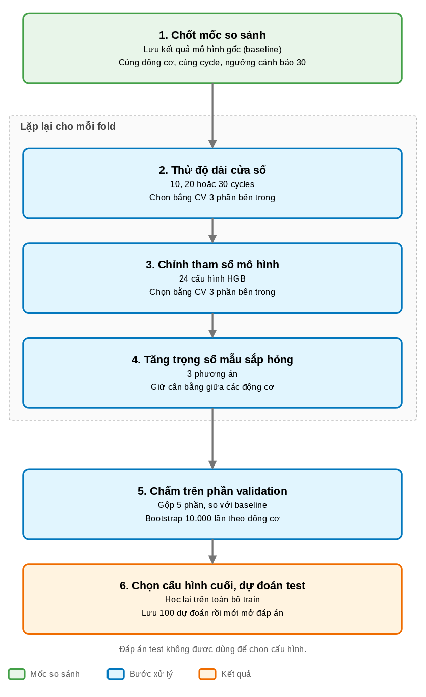

# Thử nghiệm cải thiện RUL FD001

Runner so sánh window 10/20/30, 24 cấu hình HistGradientBoosting và ba phương án
trọng số RUL. Mục tiêu là giảm sai số ở vùng RUL không quá 30 cycles, đồng thời
kiểm soát sai số toàn bộ, cảnh báo trễ và thời gian báo sớm. Đợt đầy đủ
`20260928_rebuild` đã hoàn tất. Run `20260927_full` được giữ làm historical
baseline để đối chiếu. Theo tiêu chí đã chốt, giữ baseline vì quy trình
mới chưa giảm sai số RUL thấp và làm tăng số cảnh báo trễ.

## Chạy và phục hồi

Từ thư mục gốc repository, sau khi ETL đã tạo Silver:

```powershell
uv sync --frozen
uv run --frozen cmapss-model-improvement --output-dir outputs/experiments/rul_improvement/20260928_rebuild
```

Chạy lại đúng lệnh để dùng lại các fit đã lưu. Runner từ chối dùng cache nếu
cấu hình, dữ liệu đầu vào, source hoặc dependency khác. Nếu thay đổi, dùng một
`--output-dir` mới. Không xóa manifest để ép chạy tiếp một đợt khác.

Ví dụ chạy kiểm tra nhỏ, không đọc test labels:

```powershell
uv run --frozen cmapss-model-improvement --output-dir tmp/rul-check --outer-splits 2 --inner-splits 2 --n-hgb-candidates 1 --bootstrap-resamples 20 --skip-test-evaluation
```

Ví dụ trên chỉ kiểm tra phần mềm. Kết quả khoa học dùng cấu hình đầy đủ 5 outer
folds, 3 inner folds, 24 candidates và 10.000 bootstrap resamples, seed 42.
Máy chạy thử có CPU Intel Core Ultra 9 185H và khoảng 23,4 GiB RAM; runner giới
hạn 4 CPU threads cho mỗi fit, không cần GPU.

## Phép đánh giá



[Nguồn draw.io](../assets/diagrams/rul-improvement-plan.drawio).

Outer folds của đợt đầy đủ lấy từ baseline. Inner folds chia theo engine trong
phần outer train. Mọi window dùng cùng 17.731 khóa từ cycle 30 của 100 train
engines. Mỗi engine có tổng trọng số train bằng 1. Metric đánh giá không dùng
trọng số ưu tiên RUL thấp.

Từng giai đoạn chọn cấu hình bằng inner predictions. Ba chỉ số kiểm soát phải
không cao hơn baseline của giai đoạn: MAE toàn bộ, tỷ lệ cảnh báo sau mốc 30
hoặc bỏ lỡ, và tỷ lệ thời gian báo sớm. Trong nhóm hợp lệ, chọn MAE RUL thấp
nhỏ nhất; hòa thì xét tỷ lệ cảnh báo trễ, MAE toàn bộ, candidate ID. Baseline
luôn là phương án dự phòng. Ví dụ giảm MAE nhưng tăng tỷ lệ thời gian báo sớm
vẫn không đủ điều kiện theo quy tắc đã chốt.

Lưu outer predictions cho baseline và ba giai đoạn để so sánh cùng engine.
Paired bootstrap lấy cùng engine IDs cho hai phương án; khoảng tin cậy chỉ
phản ánh độ bất định trên predictions đã fit, chưa gồm biến thiên do refit.
Sau đó chạy lại inner selection trên toàn bộ train, fit model cuối và ghi 100
test predictions trước khi ghép nhãn. FD001 test đã được xem ở các phân tích
trước và dry-run ban đầu; không gọi đây là test chưa từng được xem.

## Mã nguồn và đầu ra

```text
src/cmapss/modeling/
├── improvement.py             # Chia fold, chọn cấu hình, cache và fit cuối
├── improvement_analysis.py    # Ablation, paired CI, hình và so sánh test
└── improvement_cli.py         # Lệnh chạy
outputs/experiments/rul_improvement/<run_id>/
├── search_manifest.json       # Config/candidates/hash trước khi fit
├── baseline_snapshot/         # Bản sao outputs/modeling trước thực nghiệm
├── source_snapshot/           # Source runner và lockfile
├── outer_assignments.csv
├── inner_assignments.csv      # outer_fold=0 là chọn cuối trên toàn train
├── fit_cache/                 # Predictions và thông tin từng fit; chỉ lưu local
├── inner_candidate_metrics.csv
├── outer_predictions.parquet  # Bốn stage, cùng engine/cycle
├── ablation_metrics.csv
├── paired_comparison.csv
├── final_selection_metrics.csv
├── selected_model.joblib
├── final_predictions.parquet
├── test_comparison.csv
├── test_paired_comparison.csv
├── predictions/final_evaluation.parquet
├── tables/final_metrics.json
├── figures/
└── run_info.json
```

Cache từng fit có danh sách train/validation engines và thời gian chạy. Khi
fit lỗi, runner ghi `*.failed.json` rồi dừng. Không tạo predictions thay thế.
Dashboard đọc đợt `20260928_rebuild` sau khi đánh giá cuối hoàn tất; báo cáo dùng
cùng CSV và hình. `outputs/modeling` vẫn là baseline để đối chiếu.

## Kiểm tra

```powershell
uv run --frozen python -m pytest tests/test_improvement.py tests/test_features.py tests/test_modeling.py tests/test_early_warning.py tests/test_dashboard.py -q
```

Nhật ký giả thuyết, chạy thử và kết quả nằm ở [journal.md](journal.md).
Không dùng metric của một lượt dry-run để tuyên bố model đã tốt hơn.

## Kết quả ngày 27/09/2026

| Outer evaluation, 100 train engines | Baseline | Sau toàn bộ lựa chọn |
| --- | ---: | ---: |
| MAE toàn bộ (cycles) | 20,2143 | 20,2459 |
| MAE RUL ≤ 30 (cycles) | 3,6676 | 3,6730 |
| Cảnh báo trễ/bỏ lỡ | 49/100 | 53/100 |
| Tỷ lệ thời gian báo sớm | 1,2933% | 1,2580% |

Chênh lệch MAE RUL thấp là +0,0054 cycles, CI 95% [-0,0506; 0,0639]. Tỷ lệ
cảnh báo trễ tăng 4 điểm phần trăm, CI [1; 8]. Đây là CI có điều kiện trên
predictions đã fit. Baseline và từng stage dùng cùng 17.731 keys.

Cấu hình cuối trên toàn train trùng baseline: window 30, learning rate 0,05,
200 vòng boosting, 31 lá tối đa, 20 mẫu tối thiểu tại lá, L2=0, trọng số uniform
trong mỗi engine. Vì vậy test MAE 15,3490, RMSE 20,5413 và low-RUL MAE 4,3830
trên 25 test engines đều giữ nguyên. Không suy luận test trajectory từ một
điểm cuối mỗi engine.

Ví dụ về đánh đổi trong **inner CV trên toàn train**: `hgb_08` giảm low-RUL
MAE từ 3,6148 xuống 3,2625 cycles (khoảng 9,75%), nhưng tăng MAE toàn bộ từ
20,3613 lên 20,6846. Đây là dữ liệu dùng để lựa chọn, chưa phải bằng chứng
ngoài mẫu độc lập cho ứng viên đó. Không đổi tiêu chí sau khi thấy kết quả.

[Thư mục kết quả](../outputs/experiments/rul_improvement/20260928_rebuild/) chứa
`ablation_metrics.csv`, `paired_comparison.csv`, `test_comparison.csv` và
`final_selection_metrics.csv`. [Validation](../outputs/experiments/rul_improvement/20260928_rebuild/validation.json)
đã đối chiếu 511 fit records, bốn stage outer, paired CI và model đã lưu.
Full suite đạt 188 tests. Dashboard có trang **Thử nghiệm cải thiện**, đọc cùng
artifact với báo cáo; AppTest đã kiểm tra trang mới và chuyển sang engine 98.

```powershell
uv run --frozen python scripts/verify_rul_improvement.py
```

Lượt đầy đủ mất khoảng 78,61 phút, gồm 511 fits riêng được cache và một fit
cuối. Các fit trùng dùng lại cache. Kết quả âm theo tiêu chí hiện tại là căn
cứ để chốt một protocol tiếp theo, không chứng minh HGB đã đạt giới hạn tốt
nhất có thể.

PNG của sơ đồ là bản xem tĩnh dựng từ XML bằng `scripts/render_rul_protocol.py`
vì phiên làm việc không có draw.io MCP hoặc Desktop CLI. Nguồn `.drawio`
vẫn chỉnh sửa được; TikZ/PDF trong báo cáo mô tả cùng quy trình.
