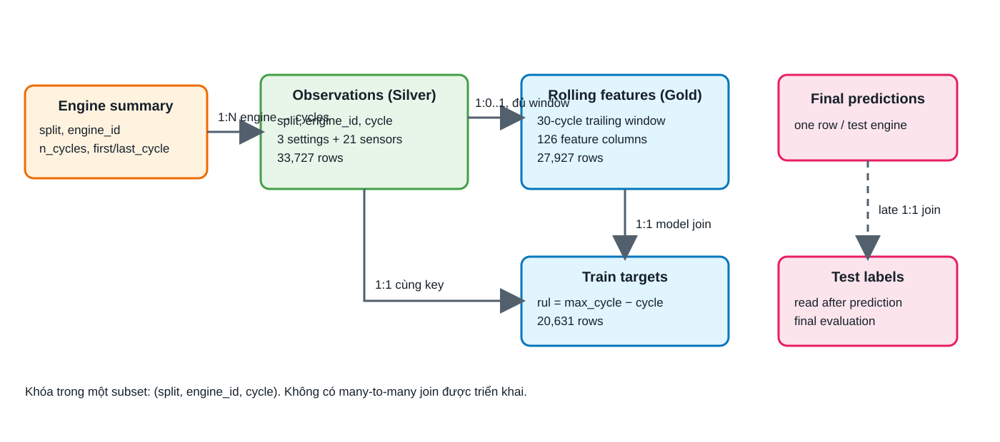

# Tổ chức, truy xuất và biến đổi dữ liệu C-MAPSS

Pipeline hiện có đọc từng subset, nối các dòng train/test có cùng schema, lưu
observations trong Parquet, tạo nhãn train và tổng hợp theo engine. Từ lịch sử
của từng engine, pipeline tạo 126 đặc trưng trên window 30 cycles để dự đoán RUL.
Tài liệu này giải thích hành vi đã triển khai, đối chiếu với code và các artifact
đã lưu đến 08/10/2026 (bổ sung khử nhiễu EWMA và lịch bảo trì). Lượt đồng bộ này không chạy lại training hay thay số liệu
khoa học; benchmark local và parity được dẫn từ run ngày 29/09, còn bằng chứng
reliability phần mềm được dẫn từ handoff ngày 07/10.

Bản trình bày đầy đủ nằm ở Mục 4 của [báo cáo](../report/main.pdf), gồm sơ đồ
luồng dữ liệu, sơ đồ quan hệ, truy vấn SQL/Spark SQL và code trích từ
`src/cmapss`. Để chạy lại từng bước và xem kết quả trung gian, mở
[`notebooks/00_data_pipeline_walkthrough.ipynb`](../notebooks/00_data_pipeline_walkthrough.ipynb)
và chạy lần lượt các ô.

## Đối chiếu yêu cầu môn học

Brief Đề tài 8 yêu cầu phân tích dữ liệu cảm biến, xử lý nhiều tín hiệu,
chuẩn hóa và tổng hợp theo time window, trực quan hóa suy giảm, dự đoán và cảnh
báo bảo trì. [Brief gốc](../references/context/assignment-brief.png) là nguồn
yêu cầu; transcript nhận dạng tiếng nói có lỗi chỉ bổ sung bối cảnh trao đổi.

| Yêu cầu | Đã thực hiện | Giới hạn cần nói rõ |
|---|---|---|
| Chuỗi cảm biến, nhiều tín hiệu | 21 sensor theo engine/cycle, EDA và thống kê train | Dữ liệu mô phỏng batch, chưa có streaming hoặc thiết bị thật |
| Chuẩn hóa và time window | Schema/type ở ETL; scaler riêng cho Ridge và Health Index; 30-cycle rolling features | HGB dùng feature theo thang gốc; không có một bước scaling chung trước mọi model |
| Xử lý nhiễu | EWMA span 10 theo từng động cơ, chỉ dùng quá khứ; giảm trung vị 86,3% dao động ngắn hạn | Không có tín hiệu sạch để chứng minh đã loại đúng nhiễu đo |
| Xu hướng và bất thường | Quỹ đạo sensor, so sánh đầu/cuối, Health Index; bất thường khi giảm quá 3σ so với 30 cycles đầu | Chưa đo được tỷ lệ báo động giả vì không có nhãn điểm bắt đầu suy giảm |
| Dự đoán/cảnh báo/lịch bảo trì | RUL test của HGB (MAE 15,35), OOF warning timing 44/7/49, lịch bảo trì 100 động cơ test (21/21 báo cần bảo trì là đúng) | Ngưỡng 30 cycles chưa hiệu chuẩn theo chi phí |
| Nội dung xử lý dữ liệu lớn | PySpark ETL và rolling local[4], Parquet nhiều tầng, parity và benchmark stage có I/O ở scale 1×/10× | Chưa đo cluster, distributed writer hay partition-aware query |

## 1. Nhiều file được tổ chức và gom thế nào?

```text
data/raw/                         Dữ liệu NASA bất biến
├── train_FD001.txt               26 trường trên mỗi dòng, không header
├── test_FD001.txt                Cùng schema observations
├── RUL_FD001.txt                 Một nhãn endpoint cho mỗi test engine
└── ...                          Ba file tương tự cho FD002–FD004
outputs/etl/                     Kết quả chính FD001
├── silver/observations.parquet   33.727 dòng, 27 cột sau khi thêm split
├── silver/train_targets.parquet  20.631 dòng, 4 cột
└── gold/
    ├── engine_summary.parquet    200 dòng, 5 cột
    └── etl.sqlite               engine_summary và train_targets
outputs/features/gold/
└── rolling_features.parquet     27.927 dòng, 129 cột
outputs/cross_dataset/FD00x/      ETL và features riêng cho mỗi subset
```

Reader tách mỗi dòng theo whitespace, yêu cầu đúng 26 trường và gán tên cột:
`engine_id`, `cycle`, ba `setting_*`, 21 `sensor_*`. Sau đó thêm `split`.
`engine_id/cycle` có kiểu int64; settings/sensors có kiểu float64.

Trong **một subset**, Pandas concat hai bảng theo chiều dòng. PySpark thực hiện
`unionByName`. Cả hai giữ `split` để phân biệt train engine 1 với test engine 1.
Đây là union các observations, không phải join lịch sử train/test với nhau.
File RUL test được giữ riêng đến đánh giá cuối; dòng thứ i của file thuộc
test engine i theo quy ước bộ dữ liệu.

FD001–FD004 hiện lưu và xử lý **riêng**, không union thành một bảng toàn cục.
Khóa `(split, engine_id, cycle)` chỉ duy nhất trong một subset. Nếu xây bảng
chung trong tương lai, cần giữ `dataset_id` trong khóa để tránh trùng engine
giữa các subset. Schema hiện tại chưa có cột đó.

Nguồn: [reader](../src/cmapss/data/readers.py),
[ETL Pandas](../src/cmapss/etl/pandas_pipeline.py),
[ETL PySpark](../src/cmapss/etl/spark_pipeline.py),
[cross-dataset](../src/cmapss/cross_dataset.py).

## 2. Lấy dữ liệu và truy vấn ở đâu?

SQLite hiện chỉ có `engine_summary` và `train_targets`, có index trên khóa.
Ví dụ SQL dưới đây chạy trên `outputs/etl/gold/etl.sqlite`:

```sql
SELECT split, engine_id, n_cycles, first_cycle, last_cycle
FROM engine_summary
WHERE split = 'train' AND engine_id = 1;

SELECT cycle, rul
FROM train_targets
WHERE split = 'train' AND engine_id = 1 AND cycle = 100;
```

Kết quả FD001 đã đối chiếu: engine train 1 có 192 cycles, từ 1 đến 192;
target tại cycle 100 là 92. Không có bảng `observations` trong SQLite này.

Để lấy các giá trị sensor, module features đọc
`outputs/etl/silver/observations.parquet` bằng Pandas, kiểm tra contract rồi
lọc `split/engine_id/cycle`. Chọn cột khóa cùng sensor cần xem là thao tác
projection (lấy một số cột). Đọc Parquet rồi lọc trong bộ nhớ khác với việc đã
triển khai query engine, SQL trên Parquet hoặc partition pruning.

Ví dụ: lấy `sensor_11` của train engine 1 ở cycles 71–100 sẽ nhận 30 dòng.
Giá trị trung bình là 47,395 theo thang gốc. Kết quả này đối chiếu được với
`sensor_11__mean` tại cycle 100 trong artifact features.
Dashboard hiện đọc predictions/metrics/Health Index đã sinh, không cung cấp
giao diện truy vấn raw sensor hoặc chạy lại ETL.

## 3. Transform diễn ra qua những bước nào?

| Bước | Input → output | Phép biến đổi và kiểm tra |
|---|---|---|
| Reader | Text → typed observations | Tách trường, gán schema/type, thêm split; lỗi width/type/key/cycle bị từ chối |
| Silver | Hai bảng train/test → observations Parquet | Concat/union, sắp theo khóa; giữ 33.727 dòng FD001 |
| Train target | Train observations → train_targets | Group theo engine lấy cycle cuối, RUL = max_cycle − cycle |
| Engine summary | Observations → 200 engine rows | Group theo split/engine, count/min/max cycle |
| Features | Observations → rolling feature rows | Sort, group theo split/engine, window 30, tính 6 thống kê/sensor |
| Model input | Train features + targets → X/y | Join one-to-one bằng 3 cột khóa, X gồm 126 features, y là rul |
| Final evaluation | Predictions đã ghi + test labels → errors/metrics | Join one-to-one theo split/engine, một prediction mỗi engine |

Transform (biến đổi dữ liệu) ở đây gồm đổi kiểu, gom dòng, tổng hợp, tạo nhãn
và tạo đặc trưng. Nó không phải kiến trúc mô hình Transformer. Việc tạo RUL
train sử dụng endpoint đã biết để tạo **nhãn**, không đưa endpoint đó vào X.
Không dùng cycle cuối test để suy ra RUL thật vì lịch sử test bị cắt.

Bước khử nhiễu riêng là EWMA span 10 trong `src/cmapss/degradation/denoise.py`:
$s_t = \alpha x_t + (1-\alpha)s_{t-1}$, $\alpha \approx 0{,}18$, tính trong từng động cơ
và chỉ dùng quá khứ. Tín hiệu EWMA đi vào Health Index và phát hiện bất thường; mô
hình RUL vẫn dùng rolling features trên tín hiệu gốc vì trung bình và độ dốc trên
window cũng làm dịu dao động. Không có bước imputation hoặc xóa outlier: EDA FD001
xác nhận không có missing values/khóa trùng, và validation từ chối đầu vào không đạt
contract.

Chuẩn hóa schema/type ở ETL khác scaling giá trị: Ridge fit StandardScaler
trên training fold; Health Index dùng cho bất thường và lịch bảo trì fit
StandardScaler/PCA trên toàn bộ train đã khử nhiễu (không dùng nhãn), còn Health
Index của phân tích ARIMA fit trên 90 train engines không thuộc 10 engine đánh giá. HGB được chọn dùng features theo thang gốc.
Không có scaler chung nằm trước bước rolling features trong pipeline RUL.

## 4. Columns, features và feature selection

Observation có 27 cột: ba cột khóa và 24 cột đo lường. Rolling features giữ
ba khóa cùng **21 × 6 = 126** cột theo mẫu `<sensor>__<stat>`: `last`, `mean`,
`std` với ddof=1, `min`, `max`, `slope`. Ba `setting_*` không đi vào X của
mô hình chính. `split`, `engine_id`, `cycle` dùng quản lý và chia fold.

Tạo 126 feature columns là feature engineering (xây dựng đặc trưng). Mô hình HGB
chính nhận đủ 126 cột và không thực hiện feature selection để giảm số cột. Thử
nghiệm mở rộng có thêm `cycle` và 42 history features (169 cột), nhưng không thay
mô hình chính.
Danh sách sensor có correlation cao hoặc có p-value nhỏ trong EDA/statistics
không được dùng để chọn sensor cho model.

Ví dụ thực tế FD001: train engine 1 kết thúc ở cycle 192. Tại cycle 100,
window lấy 30 observations từ 71 đến 100. `sensor_11__last = 47,64`,
`sensor_11__mean = 47,395`; train target là `192 − 100 = 92` cycles.
Cycle 101 không tham gia feature tại cycle 100. Join features/targets giữ
17.731 train rows, không nhân lên thành các tổ hợp cycles.

Một engine dài T cycles có T−29 feature rows với window 30.
Tổng FD001: 20.631−100×29 = 17.731 train rows;
13.096−100×29 = 10.196 test rows. Engine quá ngắn khiến pipeline báo lỗi,
không tự loại engine, padding hoặc rút ngắn window.

## 5. Quan hệ dữ liệu và join



[Nguồn draw.io](../assets/diagrams/data-relations.drawio).

| Hai đối tượng | Quan hệ trong một subset | Cách sử dụng |
|---|---|---|
| Engine summary – observations | 1:N theo split/engine | Một engine có nhiều cycles |
| Train observation – train target | 1:1 theo split/engine/cycle | Một nhãn cho mỗi observation train |
| Observation ở endpoint – feature row | 1:0..1 theo split/engine/cycle | 29 cycles đầu chưa đủ window; từ cycle 30 có một row |
| Train feature – train target tương ứng | 1:1 trên các khóa đủ window | Join có `validate="one_to_one"` trong modeling |
| Final prediction – test label | 1:1 theo split/engine | Nhãn endpoint, đọc sau khi ghi prediction |

Một window phụ thuộc 30 observations; các window kế tiếp chồng lấn 29
observations. Đây là dependency tính toán theo thời gian, không phải một bảng
many-to-many join đã triển khai. 126 feature columns cũng không tạo quan hệ
1:N giữa các bản ghi. Không cần thêm bảng liên kết nhiều-nhiều nếu bài toán
không có thực thể yêu cầu quan hệ đó.

Ví dụ join sai: engine 1 có 163 train feature rows và 192 target rows.
Join chỉ bằng engine ID sẽ ghép mọi feature cycle với mọi target cycle,
tạo 163×192 = 31.296 dòng. Join đầy đủ ba khóa trả đúng 163 dòng.
Index trong SQLite hỗ trợ truy vấn; unique key validation nằm ở code,
không có foreign key constraint được khai báo trong SQLite hiện tại.

## 6. Phần Big Data được thể hiện thế nào?

Phần xử lý dữ liệu phải trình bày được input/output, schema, grain (đơn vị
của một dòng), khóa, union/join, group/window, lưu trữ và truy xuất trước khi
nói metric model. Project minh họa các nội dung này bằng batch ETL nhiều file,
Parquet, ba boundary PySpark tương đương Pandas và phép đo tổng hợp theo scale.

PySpark benchmark chạy `local[4]` với bốn partition và heap driver/executor 4 GiB.
Cùng input Parquet được đo ở scale 1× (33.727 observations) và 10× (337.270
observations), ba lượt cho mỗi engine. Stage gồm đọc, engine summary, rolling
features và ghi; startup Spark được báo riêng, còn peak RSS lấy theo cả process
tree. Lượt ghi Spark qua `toArrow` rồi PyArrow trên driver trong môi trường
Windows, nên `write_seconds` và `pipeline_seconds` không phải phép đo của
distributed writer. Parity tại scale 1× cho toàn bộ 27.927 rolling rows × 126
features khớp với tolerance $10^{-7}$; ETL boundary cũng có `max_abs_diff = 0`.

Không có distributed cluster, Airflow DAG hoặc Power BI. Không gọi giữ
Parquet theo thư mục subset là đã `partitionBy engine`. Dữ liệu scale 10× là bản
nhân bản để đo chi phí kỹ thuật, không dùng để huấn luyện và không đại diện cho
workload production. Không dùng benchmark local để kết luận Spark nhanh hơn trên
cluster.

Cách trình bày phù hợp: báo cáo áp dụng các thao tác tổ chức và xử lý dữ liệu
trong môn Phân tích dữ liệu lớn cho bài toán cảm biến time series; evidence
Spark hiện giới hạn ở pipeline local, parity và benchmark có I/O. Đây là bằng
chứng về tính đúng và khả năng chuyển implementation, không phải tuyên bố đã có
hạ tầng phân tán production.

## 7. Reliability và khả năng truy vết

Đợt kiểm tra phần mềm ngày 07/10/2026 được ghi tại
[`CODE_RELIABILITY_20261007.json`](archive/CODE_RELIABILITY_20261007.json) và kế hoạch
được mô tả tại [`CODE_RELIABILITY_PLAN_20261007.md`](archive/CODE_RELIABILITY_PLAN_20261007.md).
Bằng chứng gồm 426 test passed và 1 test skip vì môi trường thiếu `torch` cho
TCN; chạy CLI từ CWD khác vẫn giữ checksum raw; worker spawn thực hiện save/load
và resume; dependency runtime và lockfile được đối chiếu. Đây là bằng chứng
reliability của code và artifact, không phải kết quả model mới.

ETL và rolling ghi ra staging rồi publish manifest sau cùng; khi validation
không đạt, output cũ được giữ và thao tác có rollback. Cơ chế này không cam kết
atomic transaction nhiều file trước mất điện, không giải quyết concurrent
read/write và chưa được kiểm chứng trên Linux. Vì vậy khi demo chỉ nói “có
staging, rollback và manifest để truy vết”, không gọi là hệ thống transaction
phân tán.

## 8. Câu trả lời ngắn khi trình bày

“Trong một subset, chương trình đọc hai file observations cùng schema rồi
union theo dòng và giữ split. Dữ liệu sensor nằm trong Parquet, bảng tổng hợp
và nhãn train nằm trong SQLite. Chương trình group theo engine, lấy 30 cycles
gần nhất, tạo 126 features rồi join đúng cycle với RUL train. Engine train 1
ở cycle 100 dùng cycles 71–100 và có target 92. Quan hệ chính là một engine
có nhiều observations; join features/targets là một–một. PySpark chạy
local[4] để kiểm tra ETL và rolling tương đương Pandas, còn modeling dùng
Pandas/scikit-learn. Benchmark scale 1×/10× có đọc và ghi, nhưng Spark ghi
qua driver nên chưa suy rộng được hiệu năng sang cluster.”

## Nguồn kiểm tra

- Schema/khóa: [data contract](../data/CONTRACTS.md).
- Feature/model input: [rolling](../src/cmapss/features/rolling.py),
  [modeling](../src/cmapss/modeling/pipeline.py),
  [model columns](../src/cmapss/modeling/contracts.py).
- Row counts/parity: [ETL](../outputs/etl/run_info.json),
  [parity](../outputs/etl/parity.json), [features](../outputs/features/run_info.json).
- Local benchmark: [run info](../outputs/benchmarks/20260929/run_info.json),
  [median summary](../outputs/benchmarks/20260929/summary.csv).
- Model/cảnh báo: [modeling artifacts](../outputs/modeling/README.md).
- Health Index: [timeseries artifacts](../outputs/timeseries/README.md).
- Demo dashboard: phần demo trong [sổ tay thuyết trình](SPEECH_SCRIPT_VI.pdf).
