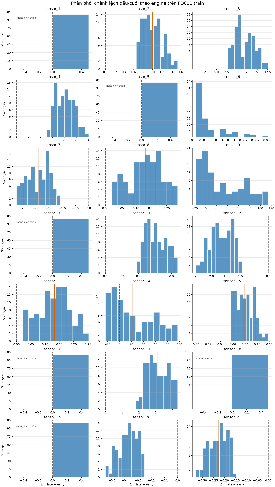
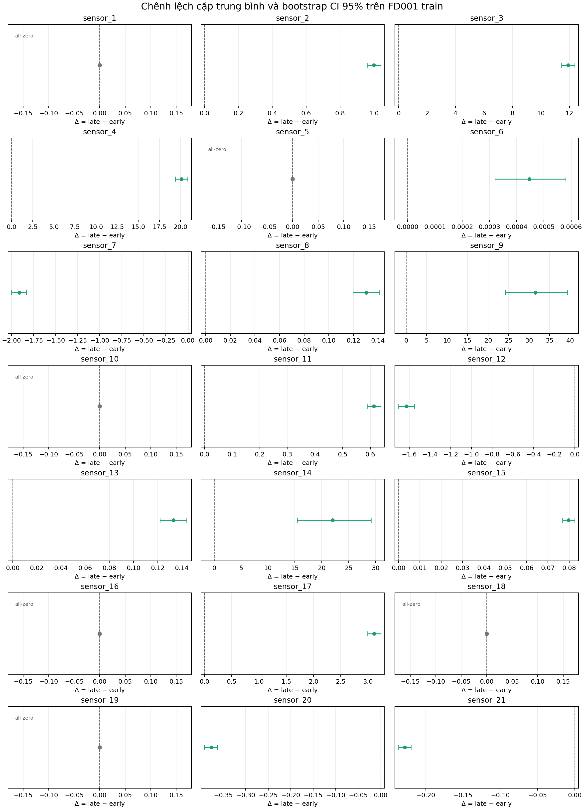

# Thống kê suy luận FD001 train

Artifact đã xuất các tệp thống kê suy luận từ
`data/raw/train_FD001.txt`. Phân tích so sánh giá trị trung bình của 30 cycles
đầu và 30 cycles cuối trong cùng một động cơ train, cho từng sensor. Đây là
bằng chứng thống kê trên train, không phải lựa chọn đặc trưng (feature selection)
và không đọc `test_FD001.txt` hoặc `RUL_FD001.txt`. Artifact gồm hai hình:
phân phối `difference` theo engine và mean paired difference kèm bootstrap CI
95%. Validation chạy lại notebook từ hai fresh kernels và chạy
train-only runtime audit có negative proof cho cả hai file test.


Nguồn sơ đồ có thể chỉnh sửa được lưu tại
[`assets/diagrams/fd001-statistics.drawio`](../../assets/diagrams/fd001-statistics.drawio).
Bản xem trước SVG được liên kết ở trên; có thể mở sơ đồ bằng URL trong
[`fd001-statistics.drawio-url.txt`](../../assets/diagrams/fd001-statistics.drawio-url.txt)
hoặc shortcut Windows
[`fd001-statistics.drawio.url`](../../assets/diagrams/fd001-statistics.drawio.url).

## Cách chạy lại

Sau khi cài các dependency từ `requirements-dev.txt`, chạy notebook từ thư mục gốc:

```powershell
.venv\Scripts\python -m jupyterlab notebooks/02_fd001_inference.ipynb
```

Chọn kernel Python của `.venv`, sau đó chọn **Restart Kernel and Run All Cells**.
Notebook gọi `write_sensor_statistics_artifacts`, ghi đè các artifact trong
`outputs/statistics/` và chạy kiểm tra round-trip CSV trước khi ghi metadata.
Sau đó notebook tạo lại hai hình PNG trong `outputs/statistics/figures/` từ
hai bảng vừa xuất.
Lần chạy hiện tại dùng Python 3.12.14, Pandas 2.3.3, NumPy 2.3.3 và SciPy
1.16.2.

Có thể chạy cùng logic không qua giao diện notebook:

```powershell
.venv\Scripts\python -c "from cmapss.statistics.artifacts import write_sensor_statistics_artifacts; write_sensor_statistics_artifacts()"
```

Lệnh này mất vài phút vì cấu hình chính thức dùng Wilcoxon permutation 100.000
resamples cho mỗi sensor kiểm định được.

Để chạy validation (focused tests, full suite, hai lần notebook,
so sánh hash của CSV/PNG và audit chặn mở file test), dùng từ thư mục gốc:

```powershell
.venv\Scripts\python -m cmapss.statistics.reproducibility `
  --project-root . `
  --notebook notebooks/02_fd001_inference.ipynb `
  --output-dir outputs/statistics `
  --work-dir tmp/statistics-reproducibility `
  --timeout 1800
```

Runtime audit này là kiểm tra cục bộ được nạp qua `PYTHONPATH`; nó không phải
filesystem sandbox, CI enforcement hoặc branch protection. Probe hợp lệ cho phép
đọc `train_FD001.txt`, còn probe âm phải bị từ chối với rule
`STATISTICS_TRAIN_ONLY` khi mở `test_FD001.txt` hoặc `RUL_FD001.txt`.

Import cũ `from cmapss.statistics_artifacts import
write_sensor_statistics_artifacts` vẫn được giữ như compatibility wrapper để
không làm hỏng notebook hoặc caller hiện tại.

## Tệp đầu ra

```text
outputs/statistics/
├── figures/
│   ├── difference_distributions.png # Phân phối difference theo engine
│   └── effect_size_ci.png           # Mean difference và bootstrap CI 95%
├── tables/
│   ├── engine_sensor_pairs.csv   # 2.100 dòng: 100 động cơ × 21 sensor
│   └── sensor_inference.csv      # 21 dòng: một dòng cho mỗi sensor
├── run_info.json                 # Input hash, phiên bản, seed và cấu hình suy luận
├── validation.json               # Validation, hash và reproducibility
└── README.md                     # File này
```

`engine_sensor_pairs.csv` chứa `early_mean`, `late_mean` và `difference =
late_mean - early_mean` cho từng `(engine_id, sensor)`. `sensor_inference.csv`
chứa chênh lệch cặp trung bình, trung vị, khoảng tin cậy bootstrap percentile
95%, thống kê Wilcoxon, p-value thô, p-value đã hiệu chỉnh theo
Benjamini-Hochberg và trạng thái kiểm định.





## Cấu hình đã dùng

Cấu hình được cố định trong `SensorInferenceConfig` trước khi chạy:

| Thành phần | Giá trị |
| --- | --- |
| Window | 30 cycles đầu và 30 cycles cuối của mỗi động cơ train |
| Chênh lệch | `late_mean - early_mean` |
| Bootstrap | Percentile CI 95%, 10.000 resamples, seed 42 |
| Wilcoxon | Two-sided, `zero_method="wilcox"`, không continuity correction |
| Permutation | 100.000 resamples, RNG tách theo sensor và mục đích |
| FDR | Benjamini-Hochberg, `q=0,05`, họ gồm 21 sensor |
| All-zero | Giữ sensor trong đầu ra; p-value thô và p-value đã hiệu chỉnh là NA |

## Kết quả kiểm tra

`validation.json` ghi trạng thái `passed`:

- `engine_sensor_pairs.csv`: 2.100 dòng, đúng 100 cặp cho mỗi sensor và 21
  sensor cho mỗi động cơ.
- `sensor_inference.csv`: 21 dòng, giữ đủ 21 sensor.
- Round-trip CSV đạt cho cả hai bảng bằng parser `float_precision="round_trip"`.
- SHA-256 của cả ba raw file (train, test observations và test labels) không đổi
  trước/sau lần validation.
- `test_data_used=false` và `test_labels_used=false`.
- Focused statistics tests đạt 26 tests; full suite đạt 95 tests.
- Notebook chạy hai lần từ fresh kernels; hai CSV và hai PNG ổn định theo SHA-256.
- Runtime audit chặn mở `test_FD001.txt` và `RUL_FD001.txt` trong negative proof.

Các con số trên là bằng chứng local của lần chạy ngày 22/09/2026 và được lưu
trong `validation.json`. Thay đổi Python, dependency, font hoặc backend
rendering có thể làm thời gian chạy hoặc hash PNG khác dù số liệu CSV vẫn đúng.

## Kết quả thống kê hiện tại

Trong 21 sensor, 6 sensor có toàn bộ `difference` bằng 0: `sensor_1`,
`sensor_5`, `sensor_10`, `sensor_16`, `sensor_18` và `sensor_19`. Các sensor
này vẫn nằm trong bảng, có CI suy biến tại 0 và `test_status =
all_zero_difference`.

15 sensor còn lại kiểm định được và đều có p-value đã hiệu chỉnh xấp xỉ
`0,000028` trong cấu hình permutation hiện tại. Theo protocol đầu/cuối 30 cycles
trên train FD001, các sensor này có chênh lệch có hệ thống giữa đầu và cuối vòng
đời sau hiệu chỉnh FDR. Ví dụ cụ thể:

| Sensor | Chênh lệch trung bình | Khoảng tin cậy bootstrap 95% | Dấu chính |
| --- | ---: | ---: | --- |
| `sensor_4` | 20,128097 | [19,402735; 20,865606] | Tăng |
| `sensor_7` | -1,913527 | [-1,999307; -1,829684] | Giảm |
| `sensor_11` | 0,613257 | [0,589017; 0,637944] | Tăng |
| `sensor_12` | -1,627190 | [-1,704288; -1,552119] | Giảm |
| `sensor_20` | -0,377007 | [-0,391534; -0,363173] | Giảm |

`p-value` rất nhỏ ở đây không đo độ lớn thực tế của thay đổi; chênh lệch cặp
trung bình và CI mới cho biết độ lớn theo đơn vị gốc của từng sensor. Không so
sánh trực tiếp độ lớn chênh lệch trung bình giữa hai sensor khác thang đo.

Hai hình suy luận làm rõ điểm này. `sensor_6` có 47 chênh lệch dương và 53 chênh
lệch bằng 0, nhưng mean difference chỉ khoảng `0,00045`. `sensor_9` có 71 chênh
lệch dương và 29 chênh lệch âm, cho thấy mean difference cần được đọc cùng phân
phối theo engine thay vì chỉ đọc một số tổng hợp.

## Giới hạn

Kết quả chỉ áp dụng cho tập train FD001 và định nghĩa hai đoạn 30 cycles tuyệt
đối. Kết quả không chứng minh quan hệ nhân quả, không xác định thời điểm bắt đầu
suy giảm và không chứng minh hiệu quả dự đoán ngoài mẫu. Danh sách sensor bác
bỏ giả thuyết không sau FDR không được dùng để chọn đặc trưng trên toàn train
trước cross-validation; feature selection cho mô hình phải nằm trong training
fold.
